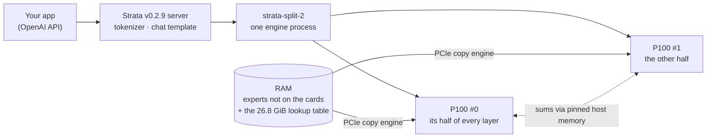

<div align="center">

# 📯 Foghorn

**Big MoE models on two retired Tesla P100s. Loud fans, fast tokens.**

Qwen3.8-Flash-Next and Edge0-145B with a 512k context on a pair of 2016 server cards.<br>
Flash-Next IQ3_S: **~67 tok/s writing · 110+ tok/s edits · ~1,000 tok/s reading a 38k-token prompt**.

[](LICENSE)


[Quick start](#-quick-start) · [Speed](#-speed) · [Models](#-models) · [How it works](#-how-it-works) · [Full guide](docs/GUIDE.md)

</div>

---

Foghorn is a port of [Strata](https://github.com/Niko1221/Strata)'s all-cards split engine (`strata-split-2`, from
[sFNX](https://github.com/johnfink8/sfnx)) to the **NVIDIA Tesla P100** (Pascal, sm_60), a card that engine was never
built for. Both cards work on every layer at once, the experts that do not fit in VRAM stream in from RAM over PCIe,
and two drafters (the model's own MTP layer and prompt lookup) let the cards check several tokens per step.

On the same two cards, our previous setup (Strata 0.2.9's layer-split engine with our P100 kernels, where one card
waits while the other works) wrote at 47-55 tok/s and read long prompts at 620-650 tok/s. Foghorn writes at **66.5**
and reads at about **1,000**.

> *Why "Foghorn"?* Under full load, the server's fans cooling two P100s sound like one, and *megla* is Slovenian for fog.

## ✨ Highlights

- 🧠 **Big MoE on old iron:** Qwen3.8-Flash-Next (IQ3_S or UD-Q4_K_XL) and Edge0-145B (6.6B active) on two 16 GB cards.
- ⚡ **Fast drafting:** the MTP draft layer plus prompt lookup of up to 15 tokens. On IQ3_S with 96 GB of RAM, code and
  text edits run at over 100 tok/s.
- 🎯 **Exact by default:** each step was checked against the build before it, with the same first-token logits (KL 0)
  and the same answers at temperature 0. A few kernel switches change only rounding. The lossy options
  (`FNX_ROUTE_PRIOR`, the Coder mask and the fast UD-Q4_K_XL profile) are off unless you set them.
- 🔌 **No NVLink, no P2P:** plain PCIe. The cards exchange their sums through pinned host memory.
- 🖼️ **Pictures, a 524,288-token context and an OpenAI-compatible API** through Strata v0.2.9's server.
- 🧰 **Tools for your machine:** `tune/check.py` finds what limits it, and `tune/tune.py` measures the exact switches on it.

## 🚀 Quick start

You need Linux, two Tesla P100 16 GB, 96 GB of RAM and CUDA 12 ([requirements](#-requirements)).
`/data/flash-next` is any folder with about 95 GB free.

```bash
git clone https://github.com/Megla123/foghorn.git && cd foghorn
bash build.sh                    # the engine, about 20 minutes
bash setup.sh /data/flash-next   # Strata v0.2.9, the model (85 GB), tokenizer, MTP layer, pictures, run config
bash run.sh /data/flash-next     # OpenAI-compatible API on http://127.0.0.1:8080/v1 after about 5 minutes
```

Then measure your machine against ours, on a freshly started engine, once (the expert cache learns, so a second run is
faster):

```bash
python3 bench/bench.py --strata-dir /data/flash-next/strata-v0.2.9 --wait
```

- `setup.sh` can be run again after an interruption (downloads resume), and `--check` only reports what is still to do.
  Set `HF_TOKEN` if Hugging Face asks for one.
- ⚠️ **Never build while the engine is loaded.** It pins most of the RAM, and a build beside it once hung our server.
- **Updating:** stop the server, `git pull`, run `bash build.sh` again, and check the [guide](docs/GUIDE.md) for
  profile changes. `setup.sh` keeps an existing `profile.json`, and an older engine ignores new switches silently.

Building by hand, preparing the files and every option are in the [full guide](docs/GUIDE.md#install).

## 📊 Speed

`bench/bench.py` on our server, tok/s, each a single run on a freshly loaded engine, exact routing (`FNX_ROUTE_PRIOR=0`),
built from this repository's 17 Nov sources (`e56c3f60`, before the 18 Nov switch):

| Model | Context | RAM | ✍️ Fresh writing | ✏️ Edits (Python / Markdown) | 📖 Cold read, 38,862 tokens |
|---|---:|---:|---:|---:|---:|
| **Flash-Next IQ3_S** (ISTA-DASLab GSQ-RCO) | 512k | 96 GB | **66.5** | **110.7 / 115.8** | **1,012** |
| Flash-Next IQ3_S, 64 GB mode ¹ | 256k | 64 GB | 63.8 | 93.6 / 99.2 | 807 |
| Flash-Next UD-Q4_K_XL (Unsloth) ² | 512k | 96 GB | 50.9 | 62.5 / 63.7 | 795 |
| Edge0-145B NVFP4 | 512k | 96 GB | 55.0 | 96.6 / 98.9 | 691 |
| ⚠️ Fast UD-Q4_K_XL, **lossy** ⁴ | 512k | 96 GB | 73.9 | 125.1 / 126.4 | 1,007 |

¹ We have no 64 GB machine: this ran in a 58 GiB memory cgroup on our 96 GB server.<br>
² Measured on 16 Nov. Since 18 Nov the UD-Q4_K_XL profiles write fresh text 3.3 % faster in our own rounds
(51.75 → 53.45 tok/s, same answers), and writing at a depth of 58.5k is 1.7-4.3 % slower. `bench.py` has not been run
with them yet.<br>
⁴ Our own test chain on 18-19 Nov, not `bench.py`; the exact UD-Q4_K_XL in the same window: 52.3, 60.2 / 63.6, 963.
Answers are worded differently from the exact profile, see [Fast UD-Q4_K_XL](docs/GUIDE.md#fast-ud-q4_k_xl).

<details>
<summary><b>Our machine</b></summary>

| | |
|---|---|
| Server | HPE ProLiant DL380 Gen10, 2 × Xeon Bronze 3106 (8 cores, 1.7 GHz) |
| RAM | 96 GB DDR4 (Linux sees 91.8 GiB) |
| GPUs | 2 × Tesla P100-PCIE-16GB, each in a PCIe Gen3 x16 slot (11.9 GB/s), power limit 185 W |
| Software | Ubuntu 26.04, NVIDIA 580, CUDA 12.4, Strata v0.2.9's server |

</details>

Every number, including deep contexts, conversation reads and pictures, is in the [full guide](docs/GUIDE.md#our-numbers).

## 🧩 Models

| Model | Set up with | Download | Notes |
|---|---|---:|---|
| [ISTA-DASLab GSQ-RCO **IQ3_S**](https://huggingface.co/ISTA-DASLab/Qwen3.8-Flash-Next-GSQ-RCO-GGUF) | `setup.sh /data/flash-next` | 85 GB | The fastest. Also runs with **64 GB of RAM** (`--ram 64`, 256k context). |
| [Unsloth **UD-Q4_K_XL**](https://huggingface.co/unsloth/Qwen3.8-Flash-Next-GGUF) | `setup.sh /data/flash-next-q4 --model q4_k_xl` | 112 GB | The larger quantization. Fewer experts fit on the cards, so edits wait for PCIe, and 96 GB of RAM is tight. |
| [Edge0 **Edge0-145B NVFP4**](https://huggingface.co/Edge0/Edge0-145B-NVFP4) | `setup.sh /data/edge0 --model edge0` | 87 GB ³ | Flash-Next with its experts in a latent space (Edge0 Community Model License). Weaker Slovenian in our tests. |
| **Coder** expert mask | `setup.sh /data/flash-next-coder --models /data/flash-next/models --coder` | none | Flash-Next only: the experts ISTA-DASLab's Coder keeps. At λ 0.15, code edits ran 11 % (IQ3_S) to 43 % (UD-Q4_K_XL) faster, but it is worse outside code and ignored instructions in Slovenian (lossy). |
| ⚠️ **Fast UD-Q4_K_XL** (lossy) | `setup.sh /data/flash-next-q4-fast --models /data/flash-next-q4/models --model q4_k_xl --fast` | none | The UD-Q4_K_XL file with the Coder mask, `FNX_ROUTE_PRIOR=1.0` and `FNX_ONEHOP=2`: 1.4x fresh writing, 2x code edits. **Answers are worded differently** from the exact profile; in our 87 code, edit and English tasks it did about as well (four loads: 0, 0, 2 and 0 failed tasks, the exact profile 1), but it may ignore instructions in other languages and is not repeatable at temperature 0. For code and English. [Details and warning](docs/GUIDE.md#fast-ud-q4_k_xl). |

³ 28.8 GB of it is the IQ3_S's second shard: point `--models` at the IQ3_S folder to share it.

One data folder holds one profile, so give each model its own folder (`--models` shares the downloads). Files whose
expert types have no P100 kernels here (Q6_K, Q3_K, Q2_K, ...) run slower than Strata itself, or not at all. On other
cards, use [Strata](https://github.com/Niko1221/Strata).

## 🔧 How it works



- **Split, not pipelined:** each card holds half of every layer, so both read their weights at the same time.
- **P100 kernels:** the P100 has no `dp4a`, no tensor cores and no `__nanosleep`, and its FP16 is fast only as paired
  `HFMA2`. Foghorn adds FP16 expert kernels for writing and for reading prompts, P100 attention, and a `dp4a` emulation
  (`engine/p100_compat.h`).
- **Experts on demand:** about 60 % of IQ3_S's experts live only in RAM. A copy-engine thread brings the missing ones
  in, with guesses for the next layer, and each expert's blocks wait only for that expert's copy.
- **Drafting:** the MTP layer drafts up to 4 tokens and prompt lookup up to 15, and the full model checks the drafts in
  one pass, which is why edits are so fast.

The build-by-build story, with the gain of each step, is in [docs/HISTORY.md](docs/HISTORY.md).

## 📋 Requirements

- **Linux x86-64.**
- **Two Tesla P100 16 GB (PCIe)**, ideally each in a **Gen3 x16** slot. The engine is built for exactly two cards of
  compute capability 6.0 and refuses other cards. P40 and GTX 10x0 (sm_61) are not supported.
- **Above 4G Decoding** on in the BIOS, so each card gets its 16 GiB BAR1. The engine refuses a card without one.
- **96 GB of RAM**, or 64 GB with the IQ3_S 64 GB mode.
- **CUDA 12.x** (CUDA 13 dropped sm_60) with a host compiler it accepts (CUDA 12.4: gcc 13 at most), CMake 3.22+,
  git and Python 3.10+. The driver must support both CUDA 12 and Pascal (the 580 branch is NVIDIA's last for Pascal).
- **Disk:** about 95 GB for IQ3_S, 112 GB of files for UD-Q4_K_XL, and 87 GB for Edge0-145B (less when it shares the
  IQ3_S shard).
- On Intel boards with VT-d, set **`iommu=pt`**: with translation on, our copies to the cards ran at 7.6-8 GB/s instead
  of about 12.

One request at a time (`--batch 1`), no `logprobs`, and the first answers after a load are slower while the expert cache
settles. What has and has not been tested is in [Known limitations](docs/GUIDE.md#known-limitations).

## 📚 Documentation

| | |
|---|---|
| [docs/GUIDE.md](docs/GUIDE.md) | **The full guide:** every measurement, each model in depth, install and run by hand, benchmarking, exact and lossy settings, other machines, known limitations |
| [docs/SWITCHES.md](docs/SWITCHES.md) | Every `FNX_*` engine switch and what each profile sets |
| [docs/HISTORY.md](docs/HISTORY.md) | How the port came about, build by build, plus what was tried and dropped |
| [tune/README.md](tune/README.md) | `check.py` and `tune.py`: diagnose and tune your own machine |
| [NOTICE.md](NOTICE.md) · [docs/PROVENANCE.md](docs/PROVENANCE.md) · [docs/upstream-v0.2.10.diff](docs/upstream-v0.2.10.diff) | What is ours and what is Strata's, file by file and line by line |

Our scripts and docs refer to sections as *(README, "Section")*. Those sections are now in [docs/GUIDE.md](docs/GUIDE.md).

## 📰 News

- **19 Nov 2026:** ⚠️ a **fast, lossy UD-Q4_K_XL profile** (`setup.sh --model q4_k_xl --fast`): the Coder mask, λ 1.0 and
  `FNX_ONEHOP=2` on the same file and engine. Fresh writing 52.3 → 73.9 tok/s, code edits 60.2 → 125.1, writing code
  50.8 → 85.6. Its answers are worded differently from the exact profile; on our own 45 functions with hidden tests,
  26 edits and 16 English questions it did about as well, in four loads. For code and English only ([why](docs/GUIDE.md#fast-ud-q4_k_xl)).
  The task set is in `bench/coding/`. The exact profiles do not change.
- **18 Nov 2026:** UD-Q4_K_XL draft-layer norm per stream (`FNX_MTP_NORM_STREAMS`) and 150 more expert slots per card.
  Fresh writing is 3.3 % faster with the same answers, and writing at a depth of 58.5k is 1.7-4.3 % slower. To get it,
  rebuild and update `profile.json` ([how](docs/GUIDE.md#unsloths-ud-q4_k_xl)).
- **17 Nov 2026:** 96-row prompt jobs for IQ3_S and Edge0-145B, so long reads are 5.3 % and 3.2 % faster.
- **16 Nov 2026:** UD-Q4_K_XL with 96-row jobs and kernel mode 6: a warm 36k read is 33 % faster in our test chain
  (the benchmark's cold read +4 %).
- **14-15 Nov 2026:** Edge0-145B support: its latent experts in NVFP4, with D and U split by group across the cards.
- **13 Nov 2026:** UD-Q4_K_XL kernels (Q4_K, Q5_K, Q5_1, Q8_0), the 64 GB mode and the Coder expert mask.

## 🙏 Credits

Built on **[Strata](https://github.com/Niko1221/Strata)** by Niko1221 and contributors, and on **[sFNX](https://github.com/johnfink8/sfnx)**
by John Fink, the split-every-layer engine Strata ported. It also uses **ggml / llama.cpp** block formats, model files by
**ISTA-DASLab**, **Unsloth** and **Edge0**, and **Qwen**'s Qwen3.8-Flash-Next. Ideas came from KaneQuah/Kmic-68's llama.cpp
fork, DeepInfer, Strata PR #4274 and Strata 0.2.12, JustVugg's Colibri engine notes, and a tester's UD-Q4_K_XL recipe.
Each is credited in the [full guide](docs/GUIDE.md#credits-and-license) and [NOTICE.md](NOTICE.md).

MIT licensed, like Strata: see [LICENSE](LICENSE) and [NOTICE.md](NOTICE.md). The Coder's expert list is Apache-2.0
([third_party/](third_party/)).
